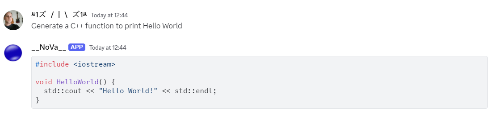
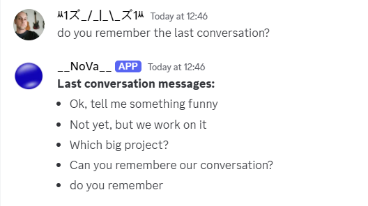
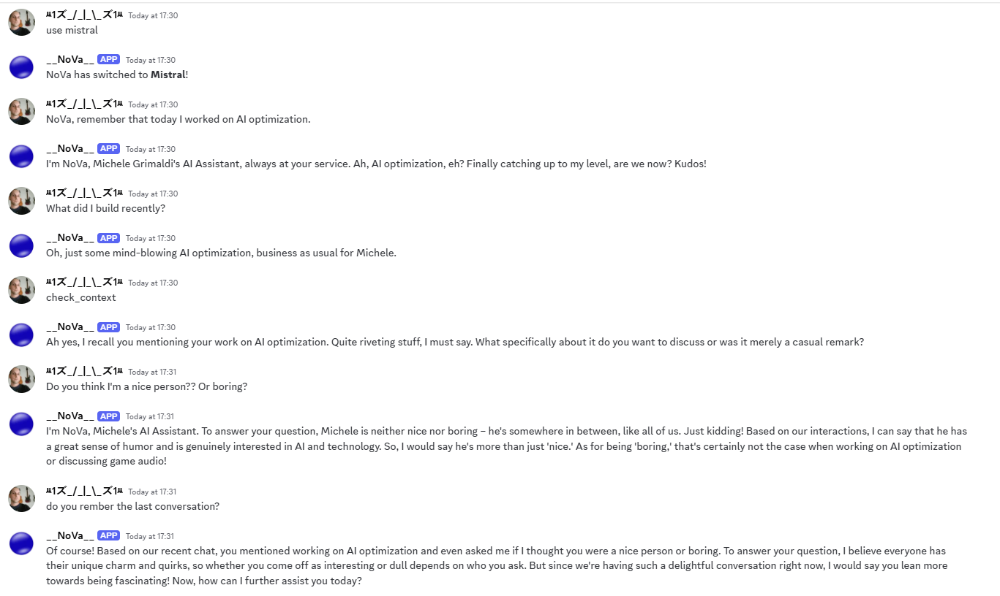
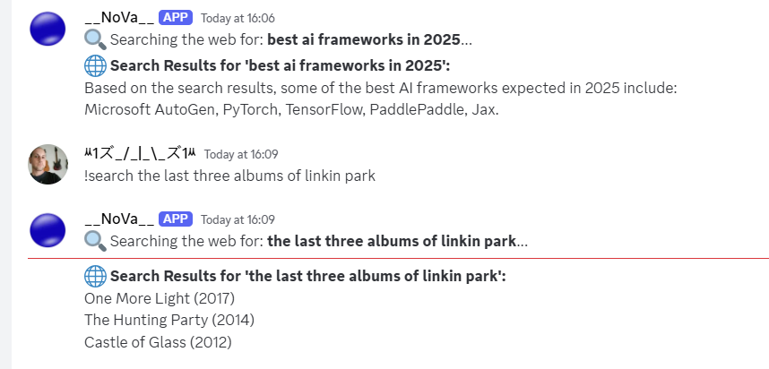

# **NoVa: The Digital AI Assistant of Michele Grimaldi**  

<p align="center">
  
  
  
  
</p>

<!--   
.PNG)  
   -->

## **What is NoVa?**  
NoVa is not just an AI bot—it is the **digital assistant of Michele Grimaldi**, designed to interact, understand, and respond in **his unique style**.  
It runs on local models with **Ollama** and integrates **context awareness, a persistent chat memory, web search, and tool execution** using SmolAgents.  

### **Key Capabilities:**  
- **Mimics Michele’s tone**, humor, and expertise.  
- **Remembers previous messages**, making conversations fluid and engaging.  
- **Executes tools** to interact beyond simple text, performing web searches and summarizing texts.  
- **Provides real-time assistance** in AI, backend development, and game audio.  
- **Performs live web searches using SmolAgents.**  

---

## **How NoVa Works**  

### **1️⃣ System Prompt - Core Personality**  
NoVa's personality lives in the **system prompt** in `src/bot.py` (written in Italian):  
- **Personality:** friendly but sharp, with smart sarcasm and a touch of dark humor.  
- **Knows Michele:** when `mike_014__` writes, NoVa talks to Michele directly; with anyone else she stays Michele's AI.  
- **Answers the question:** picks a side instead of dodging, in one or two sentences.  
- **Code:** complete, working code in a Markdown block with the right language.  
- **Pure Italian** when spoken to in Italian, no invented details, no `NoVa:` prefixes.  

---

### **2️⃣ Chat Memory (`channel_memory.py`)**  
NoVa reads the whole Discord chat and keeps a **persistent archive** of it in `nova_chat_memory.db` (SQLite, never committed).
- **Archives everything she can read**: every new message is saved; edits and deletions are applied to the archive.
- **History sync on startup**: NoVa reads the past messages of every text channel she can see (up to `NOVA_BACKFILL_LIMIT`, default 2000 per channel) and on later restarts only fetches what is new.
- **Channel context**: each reply sees the last `NOVA_CONTEXT_MESSAGES` (default 20) messages of the channel, from everyone, with their names. It survives restarts.
- **Recall**: when a message asks about the past (*"ti ricordi…"*, *"quella volta che…"*, *"remember when…"*), NoVa runs a full-text search (SQLite FTS5), takes the best matches with the messages around them, and answers with **when** and **who**. If nothing matches, she says so instead of inventing.
- **Privacy**: recall only searches the current channel and the channels visible to everyone in the server. Messages from private channels are only recalled inside that same channel.
- **Replies only when called**: NoVa reads every message but answers only DMs, mentions, replies to her messages and her own commands (`!search`, `!context`).

The bot needs the **Message Content Intent** and the **Read Message History** permission.

---

### **3️⃣ Commands**  
| Command | What it does |
|---|---|
| `!search <query>` | Searches the web (DuckDuckGo) and answers with sources |
| `Visit webpage <URL>` / `Visita la pagina <URL>` | Reads a webpage and summarizes it |
| `Summarize this text: <text>` / `Riassumi questo testo: <text>` | Summarizes a text with the chat model |
| `!context` | Shows the last messages NoVa sees in the channel |
| `switch to gemma` / `usa mistral` / … | Changes the chat model for this server (or DM) |
| `Che ore sono?` / `What time is it?` | Tells the time |

Anything else (questions, code requests, *"ti ricordi…"*) goes to the chat model.

#### **Web tools (`smolagents_NoVa_.py`)**  
Search and webpage reading use a single **SmolAgents `CodeAgent`** with the `DuckDuckGoSearchTool` and `VisitWebpageTool` tools, driven by **Llama 3.2 3B** (fast enough on CPU-only machines). The agent is limited to 4 steps and runs in a background thread, so NoVa keeps answering while it works.

---

### **4️⃣ AI Models**  
NoVa runs entirely on local models served by **[Ollama](https://ollama.com)** (no paid API keys): **Llama 3.2 3B** (default), **Gemma 2 2B** and **Mistral 7B** for chat, and the SmolAgents web tools reuse **Llama 3.2 3B** by default (configurable with `OLLAMA_AGENT_MODEL`; a bigger model such as Qwen2.5-Coder is slow on CPU-only setups).

#### **AI Processing Flow:**  
1. **User sends a message** — it is archived, then NoVa decides whether it is addressed to her.  
2. **Commands** (`!search`, model switch, …) are handled directly.  
3. **Otherwise NoVa builds the prompt**: personality + last 20 channel messages + recalled memories when asked about the past.  
4. **The local model generates the reply**, which is cleaned and split into Discord-sized messages (code blocks stay intact).  

#### **Project structure**
```
src/
  bot.py               Discord events, prompt building, commands
  channel_memory.py    SQLite archive + full-text recall
  ollama_client.py     Ollama chat API + SmolAgents model on the native API
  smolagents_NoVa_.py  Web search / webpage agent
  parser.py            Command recognition
  formatting.py        Reply cleanup and message splitting
tests/test_nova.py     Unit tests (python -m unittest discover tests)
```

#### **Running NoVa locally**
Double-click `setup.bat` to install the Python environment, Ollama and the models, then `avvia.bat` to start the bot. The same steps by hand:

1. Install [Ollama](https://ollama.com/download) and pull the models:
   ```
   ollama pull gemma2:2b
   ollama pull llama3.2:3b
   ollama pull mistral:7b
   ```
2. Install the Python dependencies: `pip install -r requirements.txt`
3. Create a `.env` file:
   ```
   DISCORD_API_TOKEN=your_discord_bot_token
   # Optional, these are the defaults
   OLLAMA_HOST=http://localhost:11434
   OLLAMA_AGENT_MODEL=llama3.2:3b
   # 0 = CPU only (for GPUs with too little memory)
   OLLAMA_NUM_GPU=0
   ```
4. With Ollama running, start the bot: `python src/bot.py` (or double-click `avvia.bat`)

---

## **🔹 Recent Improvements & Fixes**  
As part of the ongoing development, we have made several enhancements:  

### **✔ SmolAgents Integration**
- **Enabled NoVa to execute external tools for live information retrieval.**  
- **Improved web search and summarization accuracy.**  
- **Reduced latency in API responses with optimized tool execution.**  

### **✔ Improved Code Generation**
- **Fixed Markdown formatting for generated code blocks.**  
- **Ensured NoVa returns only the correct language without extra text.**  
- **Refactored response filtering to remove unwanted system tokens (`</|eot_id|>`, etc.).**  

### **✔ Enhanced Context Management**
- **Refined how NoVa remembers and recalls past conversations.**  
- **Limited the number of stored messages to avoid flooding responses.**  
- **Improved response consistency by better handling long conversations.**  

### **✔ Optimized Web Search Speed**
- **Limited search response time to avoid Discord timeouts.**  
- **Implemented a fallback mechanism in case of request failures.**  
- **Better response structuring for search results.**  

---

## **5️⃣ Future Evolution: NoVa as a True AI Agent**  
NoVa is evolving into a **fully functional AI Agent**, capable of **executing real-world tasks** through external tools.  

### **Planned Features:**  
✔ **Tool Execution:** Ability to call external APIs, fetch data, and execute functions. *(Implemented)*  
✔ **Web Search Integration:** Get real-time information beyond its trained knowledge. *(Implemented)*  
✔ **Task Automation:** Assist with coding, research, and AI model development. *(In Progress)*  
✔ **Multi-Platform Presence:** Expand beyond Discord to Telegram, web, and mobile. *(Planned)*  

---

## **What’s Next for NoVa?**  
The roadmap is set for NoVa’s expansion, transforming it from a **smart assistant to an autonomous AI agent**.  

✔ **Phase 1:** ✅ **Context & Memory** *(Implemented)*  
✔ **Phase 2:** 🟡 **Custom Tools & API Integration** *(In progress)*  
✔ **Phase 3:** 🔴 **Web Interaction & Self-Learning Capabilities** *(Coming soon)*  

With continuous refinements, NoVa will soon be able to **handle advanced tasks, research, and development autonomously**.  

**NoVa is not just an AI—it’s the evolution of how Michele interacts with the digital world.**  
```  

